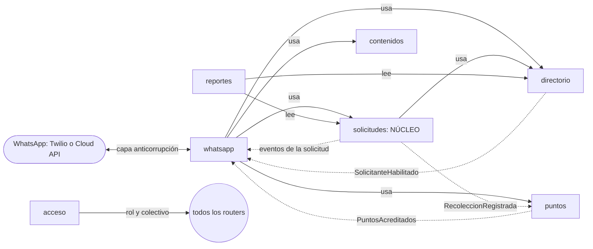
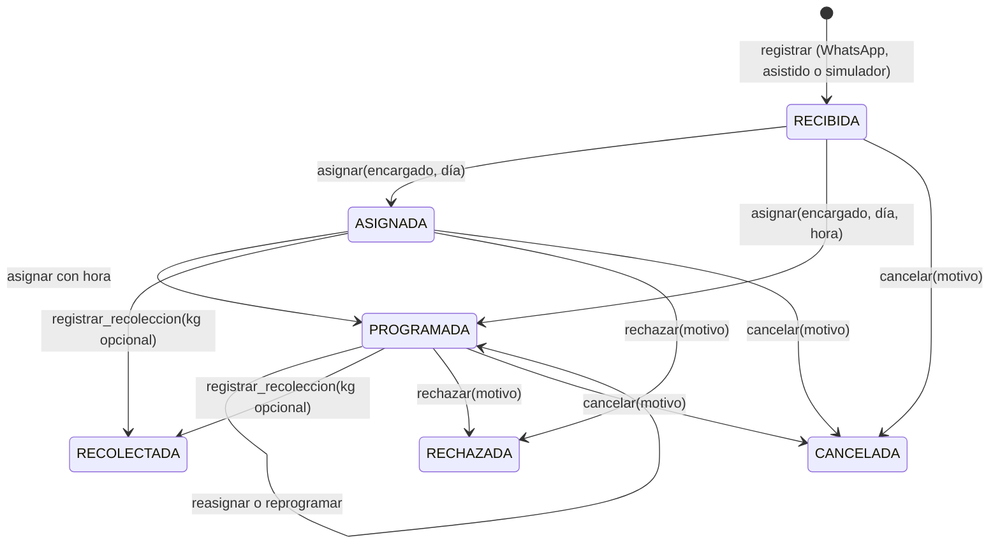
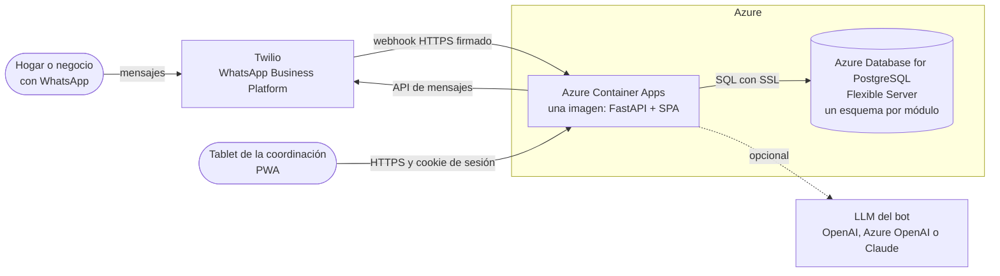

# Arquitectura de EcoConecta

> Las decisiones salen de las tres rondas de planeación del 20/11 y están en [adr/](adr/). El lenguaje está en
> [GLOSARIO.md](GLOSARIO.md) y el reto oficial en [reto/](reto/).

## En una frase

Un monolito modular: un proceso FastAPI con siete módulos que solo se hablan por su contrato, y una SPA en React que
sirve el mismo contenedor. El solicitante usa WhatsApp; el coordinador, una tablet.

## Actores

| Actor | Entra a la webapp | Cómo participa |
|---|---|---|
| Solicitante (hogar o unidad productiva) | No | Por WhatsApp se registra, pide y consulta estado, puntos y contenidos |
| Coordinador de huerteros | Sí, en la tablet | Bandeja de orgánicos: asigna, programa y registra el resultado |
| Coordinador de recicladores | Sí, en la tablet | Lo mismo con los reciclables |
| Administrador (fundación) | Sí | Usuarios, zonas, encargados, contenidos y regla de puntos; ve todo |
| Encargado (huertero o reciclador) | No | Recoge. El coordinador registra en su nombre y el historial guarda a los dos |

## Mapa de contextos

## Módulos

| Módulo | Qué hace | Publica | Escucha | Hoy | Se migra a |
|---|---|---|---|---|---|
| solicitudes | Núcleo: ciclo de vida, bandeja, asignación (con o sin hora), cancelación y resultado | SolicitudRecibida, SolicitudProgramada, RecoleccionRegistrada, SolicitudRechazada, SolicitudCancelada | — | Jairo | — |
| directorio | Solicitantes (alta y habilitación), encargados y zonas | SolicitanteHabilitado | — | Jairo | — |
| puntos | Regla con versión, libro de movimientos, premios y canjes (ADR-0008) | PuntosAcreditados, CanjeEntregado | RecoleccionRegistrada | Jairo | — |
| whatsapp | Registro por WhatsApp, bot, avisos y monitor con toma de control | — | los eventos de arriba | Jairo: menú, simulador y monitor | Conversador LLM: Leonardo · Transporte: Jorge |
| contenidos | Educación ambiental y tutoriales por audiencia | — | — | Jairo | — |
| clasificacion | Revisa si los residuos de una foto están bien separados; orientativo (ADR-0011) | — | — | Leonardo | — |
| reportes | Resumen por flujo, estado y periodo; CSV sin datos personales | — | — | Jairo | — |
| acceso | Login, roles y colectivo del coordinador | — | — | Jairo | — |
| frontend | App de Daniela (módulo `ecoconecta-coordinacion`) más el host: sesión, API y pantallas extra (ADR-0007) | — | — | Daniela: módulo · Jairo: host | — |
| despliegue | Azure | — | — | `deploy/azure.sh` | Leonardo |

Jairo construye todo de punta a punta sin esperar; cada pieza del equipo entra por el mismo contrato cuando esté lista.

## Reglas de la frontera

1. Desde otro módulo solo se importa `contrato.py`. `backend/tests/test_arquitectura.py` falla si alguien cruza por
   otro lado, y también vigila tamaños, nombres y comentarios (ADR-0006).
2. `dominio.py` no conoce FastAPI ni la base de datos.
3. Un `contrato.py` lo cambia su dueño, avisando al grupo. El núcleo compartido (`backend/app/compartido`) solo cambia con
   acuerdo de todos.

## La Solicitud

- **RN-01:** el flujo decide el colectivo y la bandeja.
- **RN-02:** no hay PROGRAMADA sin encargado, día y hora; sin hora queda ASIGNADA y no se avisa al vecino.
- **RN-03:** queda quién asignó (el coordinador) y quién recoge (el encargado).
- **RN-04:** código corto por flujo (ORG-0042, REC-0017) e historial de cada cambio.
- El aviso de «recibida» pide escribir el código en la bolsa. Al pesar, la coordinación lo busca en la tablet y registra
  los kilos en la solicitud correcta.
- Una sola solicitud abierta por solicitante y flujo.
- «No había nadie» no es un rechazo: se reprograma.
- El sistema sugiere los encargados de la zona; asigna el coordinador (§9).

## Puntos

- **RN-05:** los puntos solo nacen de RecoleccionRegistrada. Una RECHAZADA da 0 puntos y una pieza educativa.
- **RN-06:** base por recolección válida más un bono por kilo si se pesó. La regla tiene versión y cada movimiento guarda
  su cálculo en texto («10 por separar bien + 2 por 2,5 kg»). Los valores (10 de base y 1 por kilo) son de ejemplo hasta
  que la fundación los valide.
- El libro de movimientos solo crece y el saldo es la suma. Con el saldo, el bot muestra «Qué puedes canjear», un texto
  que edita el administrador. El canje se hace en la huerta y todavía no descuenta puntos.

## Alta del solicitante (RN-08)

1. Escribe al WhatsApp, autoriza el uso de sus datos (Ley 1581) y dice si es hogar o negocio, su zona, su dirección y un
   nombre o alias. Queda PENDIENTE.
2. El coordinador o el administrador lo habilita, y le llega un aviso.
3. El registro asistido desde la tablet y las unidades piloto de la fundación entran ya habilitados.

No se pide cédula, correo ni edad.

## Contenidos

Cada contenido tiene propósito (educación o tutorial), audiencia (solicitante, coordinador o encargado), flujo (o
general), formato y URL. Por WhatsApp llega con el menú «5 Aprender» y, tras un rechazo, la pieza del flujo. En la tablet
están la Ayuda del coordinador y el Material para encargados (video o imagen, sin texto, porque algunos no leen).

## Avisos por WhatsApp

Recibida (con el código) · programada (día, hora y encargado) · resultado (kilos, puntos y saldo) · rechazo (motivo y
pieza educativa) · cancelación · habilitación. Son plantillas fijas: no las escribe el LLM.

## Despliegue

| Recurso | Servicio | Para qué |
|---|---|---|
| Cómputo | Azure Container Apps | La imagen única con la API y la SPA; su HTTPS es también el del webhook |
| Base de datos | Azure Database for PostgreSQL Flexible Server | Un esquema por módulo; modelo en [modelo-de-datos.md](modelo-de-datos.md) |
| Almacenamiento | Ninguno propio | Los contenidos son URLs públicas |
| Redes | Ingreso HTTPS de Container Apps; firewall de PostgreSQL abierto solo a Azure | La tablet, Twilio y el jurado entran por la misma URL |
| Mensajería | Twilio (sandbox de WhatsApp) | Entrada y salida de WhatsApp detrás del puerto `Transporte` |

## Estado del esqueleto

- **Hoy:** los contratos funcionan sobre PostgreSQL con un esquema por módulo, y el escenario de demostración del reto
  corre completo (`backend/tests/test_flujo.py`). Hay un transporte básico de Twilio con webhook firmado y un host React
  con las pantallas de la coordinación.
- **Sigue:** el despliegue en Azure y el LLM del bot (Leonardo), la identidad visual y las pantallas de administración
  (Daniela) y la API de WhatsApp definitiva (Jorge).
