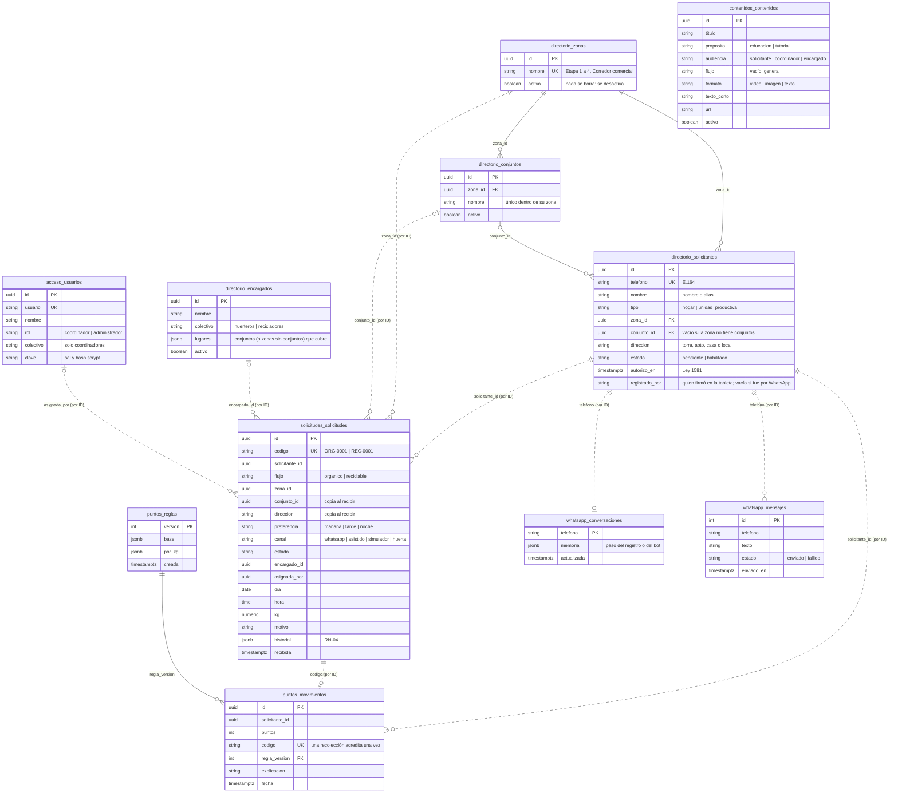

# Modelo de datos

PostgreSQL con un esquema por módulo (ADR-0001). Dentro de un módulo hay claves foráneas; entre módulos, las referencias
van por ID y sin clave foránea (líneas punteadas), para que cada módulo pueda cambiar sus tablas sin romper a otro. Las
tablas salen de `backend/app/modulos/<módulo>/tablas.py`.

## Reglas que viven en la base

- **Una sola solicitud abierta por solicitante y flujo:** índice único parcial `una_abierta_por_flujo` sobre
  `(solicitante_id, flujo)` cuando el estado es recibida, asignada o programada.
- **Códigos cortos:** las secuencias `solicitudes.consecutivo_organico` y `solicitudes.consecutivo_reciclable`.
- **El libro de puntos solo crece:** nada actualiza ni borra `puntos.movimientos`, y `codigo` es único, así que una
  recolección no puede acreditar dos veces.
